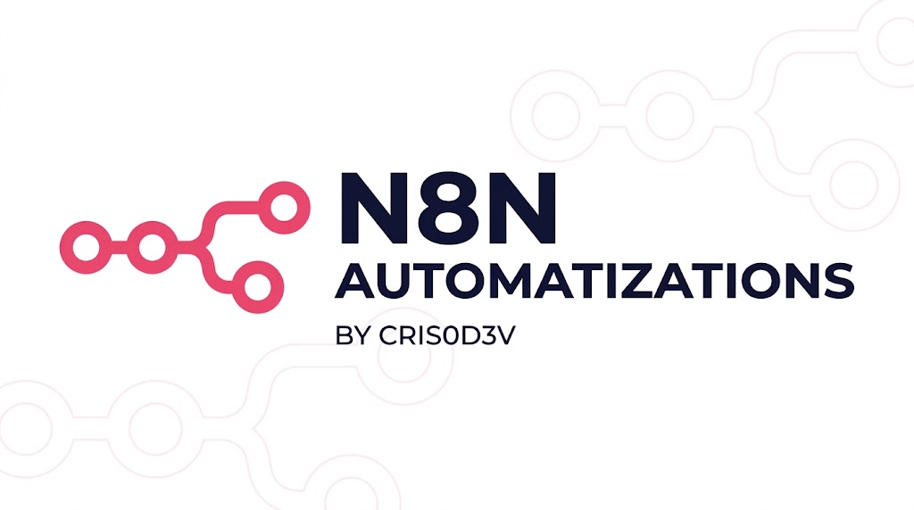

# ⚡ n8n & Automations Playground

  A personal space to explore workflow automation, API integrations, and practical solutions with n8n.

  
  
  
  

## 🎯 About

This repository is where I experiment with n8n to understand how workflows can connect services, automate repetitive tasks, and simplify everyday processes.

The goal is to build practical examples, explore different integrations, and document what I learn along the way.

## 🧪 Areas of Exploration

- **Workflow Automation:** Automating repetitive tasks and connecting different services.
- **API Integrations:** Working with REST APIs, HTTP requests, and webhooks.
- **Data Processing:** Transforming, validating, and organizing data with workflow nodes.
- **Notifications:** Exploring automated alerts and messaging workflows.
- **AI Integrations:** Experimenting with AI-powered workflows and language model integrations.

## 📂 Workflows

Workflows will be documented here as they are developed.

Each example will include its purpose, the services or nodes involved, setup instructions, and any relevant configuration requirements.

## 🛠️ Tools

  
  
  
  

Additional tools and services will be documented as they become part of individual workflows.

## 🔒 Security

- Credentials, access tokens, and API keys must not be committed to the repository.
- Sensitive configuration should be managed through n8n credentials or environment variables.
- Workflow exports should be reviewed before being published to ensure they contain no private information.

## 📌 Project Status

This repository is a work in progress. Examples and documentation will be added as new workflows are built and tested.

## 📄 License

This project is licensed under the MIT License. See the [LICENSE](LICENSE) file for details.

## Autor

by: Cristian Martínez - [cris0d3v](https://github.com/cris0d3v).
